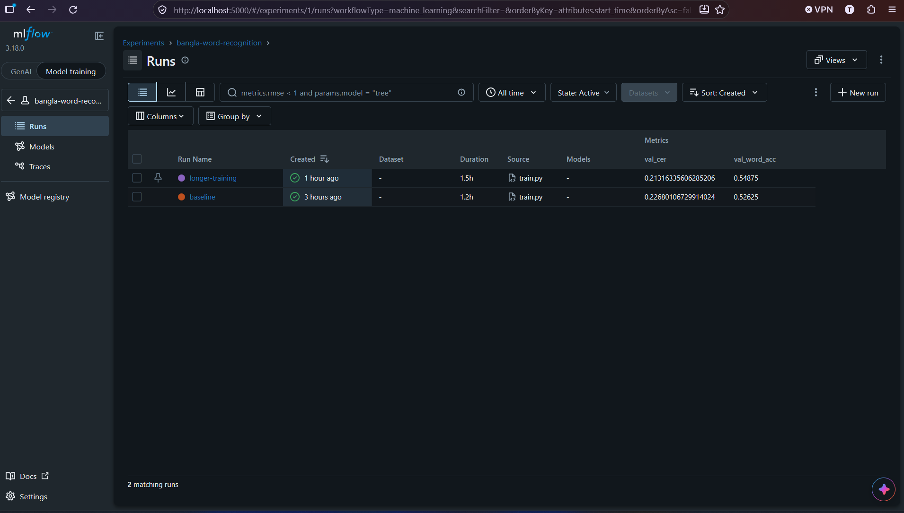
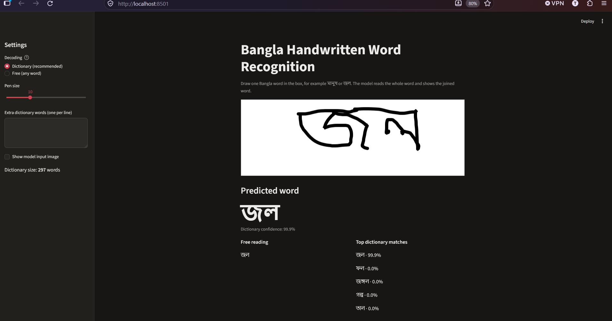

# Bangla Handwritten Word Recognition System

SICIP (Skills for Industry Competitiveness and Innovation Program), BRAC University, Assignment 04

| | |
|---|---|
| **Name** | Md. Tawhid Anwar |
| **Student ID** | 1000129281 |
| **Repository** | https://github.com/tawhidanwar/bangla-ocr |

The user draws one Bangla word in a Streamlit page and the app shows the **whole predicted word**, for example a drawing of **মানুষ** is shown as **মানুষ** and a drawing of **জল** as **জল**. The model is trained on BanglaLekha-Isolated, experiments are tracked with MLflow, and the app runs in Docker.

---

## 1. Approach

### The problem
BanglaLekha-Isolated contains **isolated characters only** (84 classes: 50 basic characters, 10 digits, 24 compound characters). It has no word images and no vowel signs (kar such as া, ি, ু). A plain character classifier can only output separate letters, which does not meet the whole-word requirement.

### The solution: a word reader trained on synthetic words
1. **Character bank.** `train.py` loads the 84 class folders, binarises each image, crops it to the ink and resizes it to a fixed height. 15% of the samples of every class are kept aside, so validation words are built from handwriting the model never saw.
2. **Vowel signs.** Since kar signs are not in the dataset, they are rendered from the Noto Sans Bengali font next to a dotted circle (◌). This tells the code where each sign sits relative to a letter (before, after or below). Each sign is then warped, wobbled and thinned so it looks less printed.
3. **Synthetic word images.** On every training step, words are composed by placing real handwritten characters side by side, adding vowel signs in the right place, sometimes drawing one shared headline (matra), and applying random spacing, overlap, slant, thickness and noise. 60% of the words come from a dictionary (`words.txt`, about 300 common words including মানুষ and জল) and 40% are random syllable strings, so the model learns to read letters, not only memorise words.
4. **Model.** A CRNN: 6 convolution blocks, then 2 bidirectional LSTM layers, then a dense output over 94 tokens (84 dataset classes, 9 vowel sign parts and the CTC blank). It is trained with **CTC loss**, so no character segmentation is needed. The input is a 64 x 256 image and the model gives 64 time steps.
5. **Joining into a word.** The output tokens are in drawing order (for example ে ব া ন for বোন). `ocr_utils.detokenize` moves the vowel signs into Unicode order and joins split signs (ে + া gives ো), so the result is a real Unicode word.
6. **Dictionary decoding.** In the app the default mode scores every dictionary word against the model output with the CTC probability and shows the best word with a confidence. A "Free" mode shows exactly what the model reads, for words outside the dictionary. Extra dictionary words can be typed in the sidebar.

### MLflow tracking
Each `python train.py` run logs:
* parameters (all arguments, number of classes, dataset sizes, model size)
* metrics per epoch: `train_loss`, `val_loss`, `val_word_acc` (exact whole-word match, free decoding), `val_cer` (character error rate), `lr`
* final metrics: `best_val_loss`, `val_dictionary_acc`
* artifacts: sample training images, `labels.json`, `words.txt` and the trained model

The tracking store is `artifacts/mlflow/mlflow.db` (SQLite) and the artifacts go to `artifacts/mlflow/mlartifacts/`.

---

## 2. Project structure

```
bangla-ocr-assignment/
|-- train.py            # trains the model and logs the run to MLflow
|-- app.py              # Streamlit drawing app, shows the predicted word
|-- ocr_utils.py        # shared code: tokens, Unicode rebuilding, preprocessing, decoding
|-- requirements.txt
|-- Dockerfile
|-- README.md
|-- labels.json         # token list, dataset class map and dictionary (written by train.py)
|-- words.txt           # dictionary of words used for training and decoding
|-- make_zip.py         # builds the source-only submission zip
|-- github_link.txt
|-- fonts/              # Noto Sans Bengali (OFL), used only to synthesise vowel signs
|-- models/
|   `-- model.keras     # trained model (best validation loss)
|-- artifacts/
|   `-- mlflow/         # MLflow tracking database and run artifacts
`-- screenshots/
    |-- streamlit_app.png
    `-- mlflow_experiment.png
```

---

## 3. How to run

### 3.1 Install
Python 3.10 to 3.13.

```bash
python -m venv .venv
# Windows: .venv\Scripts\activate      Linux/macOS: source .venv/bin/activate
pip install -r requirements.txt
```

### 3.2 Get the dataset
Download BanglaLekha-Isolated from Mendeley Data: https://data.mendeley.com/datasets/hf6sf8zrkc/2

Extract it into `data/` so that the class folders `1` to `84` are somewhere inside `data/BanglaLekha-Isolated/` (for example `data/BanglaLekha-Isolated/Images/1/...`). The script finds the folders automatically. The `data/` folder is ignored by git.

### 3.3 Train (two MLflow runs)

```bash
python train.py --run-name baseline --epochs 8 --steps 200
python train.py --run-name longer-training --epochs 10 --steps 250
```

Useful options: `--epochs`, `--steps` (batches per epoch), `--batch-size`, `--lr`, `--lstm-units`, `--dropout`, `--max-per-class`, `--lexicon-ratio`, `--data-dir`. Run `python train.py --help` for all of them. Each run saves its best model to `models/model.keras`, so the last run you train is the one the app uses.

Training runs on a normal CPU. With the defaults (20 epochs x 300 batches of 64) expect roughly 1 to 3 hours per run on a laptop CPU, depending on the number of cores. For a quicker run use `--epochs 10 --steps 200`. A GPU is faster but not required.

### 3.4 Open MLflow

```bash
mlflow ui --backend-store-uri sqlite:///artifacts/mlflow/mlflow.db --host 0.0.0.0 --port 5000
```

Then open http://localhost:5000 and choose the experiment **bangla-word-recognition**.

### 3.5 Run the app locally

```bash
streamlit run app.py
```

Open http://localhost:8501, draw a word with the mouse or a pen, and the predicted word appears under the canvas.

### 3.6 Run with Docker
Train first so that `models/model.keras` and `labels.json` exist, then:

```bash
docker build -t bangla-ocr-app:0.1 .
docker run -p 8501:8501 bangla-ocr-app:0.1
```

Open http://localhost:8501.

### 3.7 Build the submission zip

```bash
python make_zip.py
```

This creates `bangla-ocr-assignment-source.zip` with source code only (no dataset, model, MLflow runs, caches or environments).

---

## 4. Results

| Run | Key settings | best val_loss | val_word_acc | val_cer | val_dictionary_acc |
|---|---|---|---|---|---|
| baseline | lstm 128, lr 1e-3, 20 epochs | | | | |
| bigger-lstm | lstm 192, lr 7e-4, 20 epochs | | | | |

The validation words are synthetic words built from held-out handwritten characters.

### Screenshots

MLflow experiment page:



Streamlit app with a predicted Bangla word:



---

## 5. Limitations

* **Synthetic training words.** The dataset has no real word images, so the model learns from words built out of isolated characters. Real joined handwriting, where letters touch and share strokes, looks different and accuracy on it is lower than the validation numbers.
* **Vowel signs are font based.** Kar signs are synthesised from a font with distortion, not from real handwriting, so unusual handwritten kar shapes may be misread.
* **Limited character set.** Only the 24 compound characters in the dataset are supported. Words that need other conjuncts, reph (র্), ya-phala (্য) or ra-phala (্র), such as সূর্য, গ্রাম or বিদ্যা, cannot be written by the model. The sidebar warns when an extra dictionary word uses such letters.
* **Dictionary mode always picks a dictionary word.** If the drawn word is not in the dictionary, the closest dictionary word is shown. Use Free mode or add the word in the sidebar for other words.
* **One word, left to right.** The app expects a single word written on one line. Long words are squeezed into a 256 pixel wide input, which hurts accuracy for very long words (more than about 12 visual tokens).
* **Drawing differences.** Mouse drawings are smoother and thinner than pen on paper. The pen size slider in the sidebar helps when results look wrong.

---

## 6. Credits

* Dataset: M. Biswas et al., "BanglaLekha-Isolated: A multi-purpose comprehensive dataset of Handwritten Bangla Isolated characters", Data in Brief 12 (2017). Mendeley Data, DOI 10.17632/hf6sf8zrkc.2
* Font: Noto Sans Bengali, SIL Open Font License 1.1 (`fonts/OFL.txt`)
